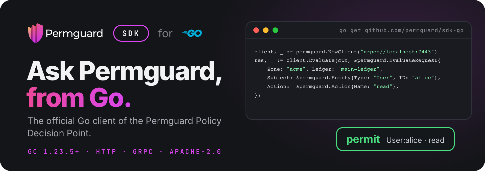

<!--
Copyright (c) 2022 Nitro Agility S.r.l.
SPDX-License-Identifier: Apache-2.0
-->

# Permguard Go SDK

[](https://pkg.go.dev/github.com/permguard/sdk-go)
[](https://www.apache.org/licenses/LICENSE-2.0)

<p align="center">
  
</p>

<p align="center">
  <a href="https://github.com/permguard/permguard"><b>Permguard</b></a> ·
  <a href="https://docs.permguard.com/"><b>Documentation</b></a> ·
  <a href="#install"><b>Install</b></a> ·
  <a href="#quick-start"><b>Quick start</b></a> ·
  <a href="#develop"><b>Develop</b></a>
</p>

**The official Go client of the Permguard Policy Decision Point.**

Before your code acts, it asks Permguard whether a subject may perform an action on a resource, and Permguard answers from the policies of a ledger.
This SDK is how Go code asks: one client for the native, stateless PDP interface `permguard.api.pdp.native.v1`, over HTTP/JSON or gRPC, with the same request and the same answer on both.

<p align="center">
  
</p>

<p align="center"><sub>Your code asks, the SDK carries the question, the data plane decides with the ledger's policies.</sub></p>

## Install

The SDK needs Go 1.23.5 or newer.

```bash
go get github.com/permguard/sdk-go
```

It needs a Permguard data plane to ask: by default it listens on port `7443`, for HTTP and gRPC alike.
See the [Permguard repository](https://github.com/permguard/permguard) to run one.

## Quick start

```go
package main

import (
	"context"
	"errors"
	"fmt"
	"log"

	permguard "github.com/permguard/sdk-go"
)

func main() {
	// grpc:// or grpcs:// speaks gRPC; http:// or https:// speaks JSON.
	client, err := permguard.NewClient("grpc://localhost:7443")
	if err != nil {
		log.Fatal(err)
	}
	defer client.Close()

	response, err := client.Evaluate(context.Background(), &permguard.EvaluateRequest{
		Zone:      "acme",
		Ledger:    "main-ledger",
		Profile:   "gateway",
		Subject:   &permguard.Entity{Type: "User", ID: "alice"},
		Resource:  &permguard.Entity{Type: "Document", ID: "budget-2026"},
		Action:    &permguard.Action{Name: "read"},
		RequestID: "example-1",
	})
	if err != nil {
		var refusal *permguard.Refusal
		if errors.As(err, &refusal) {
			log.Fatalf("refused: class=%s code=%s message=%s", refusal.Class, refusal.Code, refusal.Message)
		}
		log.Fatal(err)
	}

	fmt.Println("permitted:", response.Decision)
}
```

The same program is in [examples/terminal](examples/terminal/cmd/main.go); set `PERMGUARD_PDP_URL` to point it at another data plane.

### The request

| Field             | What it says                                                            |
| ----------------- | ----------------------------------------------------------------------- |
| `Zone`, `Ledger`  | the ledger whose policies decide, in its zone                           |
| `Profile`         | the profile of the ledger's manifest that selects the partitions to run |
| `Subject`         | who asks: a type and an id, with optional properties                    |
| `Resource`        | what is acted on: a type and an id, with optional properties            |
| `Action`          | what is done: a name, with optional properties                          |
| `Context`         | any other fact the policies read                                        |
| `PartitionInputs` | runtime data for the partitions of the profile, see below               |
| `RequestID`       | your id for the call, given back in the answer                          |

### The answer

A deny is not an error: it is a successful response with `Decision == false`.
Validation, authorization, availability and server failures are returned as `*permguard.Refusal`, with their stable `Class` and `Code`.

## Partition inputs

Runtime data is addressed to the partition name the ledger's profile declares:

```go
request.PartitionInputs = permguard.PartitionInputs{
	"authorization": {
		Type: "permguard.cedar.entities.v1",
		Data: []any{
			map[string]any{
				"uid":     map[string]any{"type": "Team", "id": "engineering"},
				"attrs":   map[string]any{"active": true},
				"parents": []any{},
			},
		},
	},
}
```

The map key must be a partition name from the selected profile.
`Type` asserts the partition's input contract; it does not select a policy runtime.

## Many evaluations at once

Set the defaults at the top level, list the `Evaluations`, and call `EvaluateMany`:

```go
response, err := client.EvaluateMany(ctx, &permguard.EvaluateRequest{
	Zone:    "acme",
	Ledger:  "main-ledger",
	Subject: &permguard.Entity{Type: "User", ID: "alice"},
	Evaluations: []permguard.Evaluation{
		{
			Resource:  &permguard.Entity{Type: "Document", ID: "budget-2026"},
			Action:    &permguard.Action{Name: "read"},
			RequestID: "read",
		},
		{
			Resource:  &permguard.Entity{Type: "Document", ID: "budget-2026"},
			Action:    &permguard.Action{Name: "update"},
			RequestID: "update",
		},
	},
	Options: &permguard.EvaluationOptions{
		EvaluationsSemantic: permguard.ExecuteAll,
	},
})
```

Each evaluation inherits what it does not set from the request.

## Endpoints and options

| Endpoint   | Transport                                      |
| ---------- | ---------------------------------------------- |
| `http://`  | JSON over HTTP                                 |
| `https://` | JSON over HTTPS                                |
| `grpc://`  | `permguard.data.v1.PolicyDecisionPoint`        |
| `grpcs://` | `permguard.data.v1.PolicyDecisionPoint` on TLS |

`NewClient` takes options after the endpoint:

| Option           | Sets                                                 |
| ---------------- | ---------------------------------------------------- |
| `WithTimeout`    | the timeout of every call                            |
| `WithTLSConfig`  | the TLS configuration, for `https://` and `grpcs://` |
| `WithHTTPClient` | the `*http.Client` used for HTTP                     |
| `WithHeader`     | a static header, also sent as gRPC metadata          |

`client.GetConfiguration(ctx)` reads the data plane's discovery document.
The client reuses its HTTP transport or gRPC channel: create it once, and call `Close` when it is no longer needed.

## Compatibility

This major version implements `permguard.api.pdp.native.v1`.
Compatibility is tied to that versioned interface, not to a server minor version.

## Develop

```bash
make protoc
make test
make lint
```

`proto/v1/pdp.proto` is generated from the canonical contract in the Permguard server repository.
A change to the contract regenerates the Go bindings and passes both the HTTP and the gRPC contract tests.

## License

Apache License 2.0: see [LICENSE](LICENSE), [NOTICE.md](NOTICE.md) and [THIRD_PARTY_NOTICES.md](THIRD_PARTY_NOTICES.md).

Permguard is a trademark of Nitro Agility S.r.l., see [TRADEMARKS.md](TRADEMARKS.md).
Go and the Go logo are trademarks of Google LLC, shown only to name the language this SDK is for.
